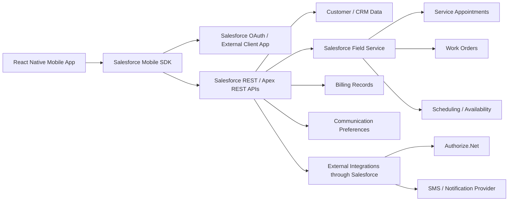
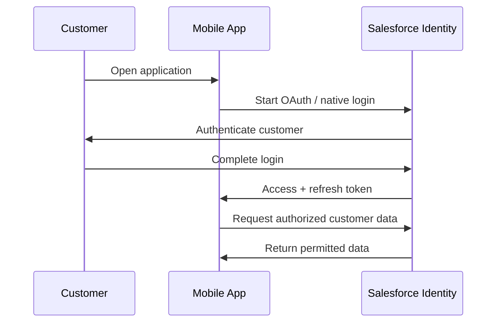
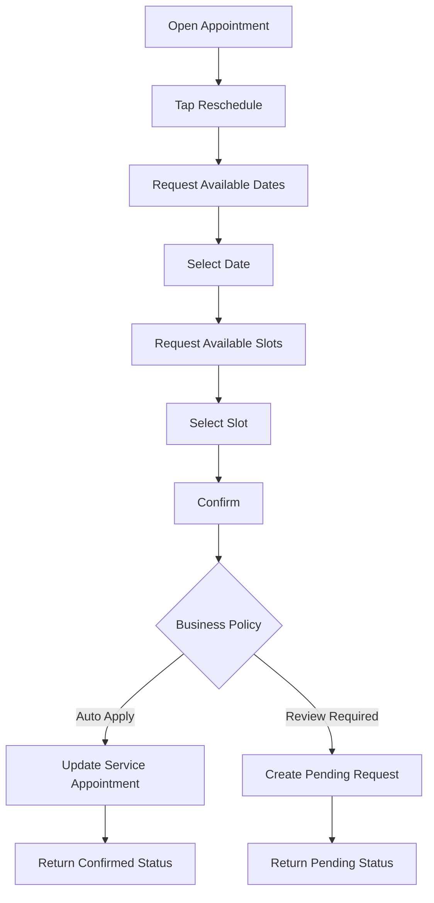

# Maid Bright Mobile App – React Native + Salesforce Mobile SDK Plan

## 1. Purpose

Build a custom Maid Bright customer mobile application for **iOS and Android** using:

- **React Native with TypeScript**
- **Salesforce Mobile SDK**
- **Salesforce OAuth / External Client App**
- **Salesforce REST APIs and/or Salesforce-hosted Apex REST services**
- **Salesforce Field Service data and scheduling services**
- **SmartStore / Mobile Sync only where offline behavior is required**

The mobile app is the customer-facing channel for managing recurring cleaning services. Salesforce remains the system of record for customer, appointment, service, and operational data.

This plan intentionally does **not** introduce AWS middleware as a default component. The preferred architecture is direct app-to-Salesforce integration through Salesforce Mobile SDK, with business logic hosted in Salesforce where needed.

---

## 2. Mobile App Goals

The mobile app should allow an existing Maid Bright customer to:

1. Sign in securely.
2. View the next cleaning appointment.
3. View upcoming and past appointments.
4. View appointment details.
5. Request a reschedule.
6. Skip an upcoming cleaning.
7. Request cancellation.
8. Request additional services.
9. Update profile and contact information.
10. Update home access instructions.
11. Update service notes for the crew.
12. View invoices, receipts, credits, and payment history.
13. Use an existing saved payment method where supported.
14. Receive appointment notifications.
15. View messages and respond to Maid Bright.
16. Manage communication preferences.
17. View the status of customer requests.

---

## 3. Proposed Architecture



### Architectural principle

The mobile app should not reproduce Salesforce business rules locally.

Examples:

- Available appointment slots come from Salesforce / Field Service.
- Cancellation deadlines are controlled by Salesforce business rules.
- Customer-to-appointment relationships are resolved in Salesforce.
- Payment card data is never stored in the mobile app.
- Customer authorization must be enforced by Salesforce, not only by the React Native UI.

---

## 4. Recommended Salesforce Integration Pattern

### Option A – Direct standard REST access

The app uses Salesforce Mobile SDK's network bridge to access Salesforce REST resources.

Use this for:

- Simple customer profile reads.
- Simple record reads.
- Low-risk standard-object interactions where permissions and data access are straightforward.

### Option B – Salesforce Apex REST service layer

Recommended for customer-facing transactional workflows.

Example endpoints:

```text
GET    /services/apexrest/maidbright/v1/me
GET    /services/apexrest/maidbright/v1/dashboard
GET    /services/apexrest/maidbright/v1/appointments
GET    /services/apexrest/maidbright/v1/appointments/{id}
POST   /services/apexrest/maidbright/v1/appointments/{id}/reschedule
POST   /services/apexrest/maidbright/v1/appointments/{id}/skip
POST   /services/apexrest/maidbright/v1/appointments/{id}/cancel
GET    /services/apexrest/maidbright/v1/services
POST   /services/apexrest/maidbright/v1/service-requests
GET    /services/apexrest/maidbright/v1/billing
PUT    /services/apexrest/maidbright/v1/profile
PUT    /services/apexrest/maidbright/v1/access-instructions
GET    /services/apexrest/maidbright/v1/messages
POST   /services/apexrest/maidbright/v1/messages
```

### Why use Apex REST for customer actions?

It keeps customer workflows independent from Salesforce object structure.

The app calls:

```text
POST /appointments/{id}/reschedule
```

instead of directly manipulating multiple Salesforce records.

Salesforce can then:

1. Validate the authenticated customer.
2. Confirm the customer owns the appointment.
3. Check business policy.
4. Check Field Service availability.
5. Update the Service Appointment / Work Order.
6. Create an approval/request record if staff review is required.
7. Return a customer-friendly response.

---

## 5. Authentication Plan

Authentication is a critical architecture decision and must be finalized before production development.

### Preferred model

Use Salesforce customer identities through an approved external identity model.

Recommended components:

- Salesforce **External Client App**
- OAuth 2.0
- PKCE
- Salesforce Mobile SDK authentication
- Experience Cloud / customer identity if required
- MFA or passwordless authentication based on the final identity model

### Mobile authentication flow



### Decisions required

Before production:

- Are all customers Salesforce external users?
- Will Maid Bright use Experience Cloud identities?
- Is passwordless / OTP login required?
- Is email, mobile number, or both used to identify a customer?
- How are existing Contact records converted/mapped to external users?
- What is the required Salesforce license model?
- What happens when duplicate Contact records exist?

Do not finalize production authentication until these points are confirmed.

---

## 6. Salesforce Mobile SDK Components

### OAuth

Use Salesforce Mobile SDK authentication for token lifecycle and Salesforce access.

### Network

Use the React Native Salesforce network bridge for authenticated Salesforce API calls.

Create a wrapper in the app so UI components never call Salesforce directly.

Example structure:

```text
src/services/salesforce/
  auth.ts
  client.ts
  dashboardApi.ts
  appointmentsApi.ts
  profileApi.ts
  billingApi.ts
  messagesApi.ts
```

### SmartStore

Use SmartStore only for data that benefits from local storage.

Possible candidates:

- Customer profile snapshot.
- Upcoming appointment snapshot.
- Service catalog.
- Recently loaded appointment history.
- Cached communication preferences.

Do not use SmartStore as the permanent source of truth.

### Mobile Sync

Consider Mobile Sync only if true offline synchronization is required.

Initial recommendation:

> Start online-first. Add offline sync only for confirmed business use cases.

This customer application is primarily for self-service and appointment changes, which require live Salesforce validation.

---

## 7. React Native Application Structure

Recommended structure:

```text
src/
├── app/
│   ├── App.tsx
│   ├── navigation/
│   ├── providers/
│   └── config/
│
├── features/
│   ├── auth/
│   ├── home/
│   ├── appointments/
│   ├── services/
│   ├── profile/
│   ├── billing/
│   ├── messages/
│   ├── notifications/
│   └── settings/
│
├── components/
│   ├── buttons/
│   ├── cards/
│   ├── forms/
│   ├── feedback/
│   └── layout/
│
├── services/
│   ├── salesforce/
│   ├── notifications/
│   └── analytics/
│
├── store/
├── hooks/
├── utils/
├── types/
├── theme/
└── assets/
```

### Development conventions

- TypeScript only.
- Functional components.
- Shared design tokens.
- API layer isolated from UI.
- Feature-based folder organization.
- Server data and UI state handled separately.
- Salesforce object names should not be spread throughout UI components.
- All user-facing errors should be translated from Salesforce/API errors into customer-friendly messages.

---

## 8. Navigation Structure

Recommended bottom navigation:

```text
Home
Appointments
Payments
Messages
Profile
```

### Navigation tree

```text
Auth
├── Welcome
├── Sign In
├── Forgot Password / Recovery
└── Verification

Authenticated App
├── Home
│   └── Appointment Detail
│
├── Appointments
│   ├── Upcoming
│   ├── Past
│   ├── Appointment Detail
│   ├── Reschedule
│   ├── Skip
│   ├── Cancel
│   └── Add Service
│
├── Payments
│   ├── Invoice List
│   ├── Invoice Detail
│   ├── Payment History
│   ├── Credits
│   └── Payment Confirmation
│
├── Messages
│   ├── Conversation List
│   └── Conversation
│
└── Profile
    ├── Personal Details
    ├── Service Address
    ├── Access Instructions
    ├── Service Notes
    ├── Notification Preferences
    ├── Help & Support
    └── Sign Out
```

---

## 9. Mobile Module Plan

### 9.1 Authentication

#### Screens

- Welcome.
- Sign in.
- Verification.
- Forgot/recover access.
- Session expired.
- Sign out.

#### Salesforce work

- Create/configure External Client App.
- Configure callback URLs.
- Configure OAuth scopes.
- Configure external-user policies.
- Define Contact/User mapping.
- Configure session and refresh-token policy.

#### Acceptance

Authenticated users can access only their own authorized customer records.

---

### 9.2 Home Dashboard

#### UI

Show:

- Customer greeting.
- Next cleaning.
- Date/time.
- Service type.
- Appointment status.
- Quick actions.
- Balance/payment summary where available.
- Latest notification.
- Recent activity.

#### API response recommendation

```json
{
  "customer": {},
  "nextAppointment": {},
  "quickActions": [],
  "billingSummary": {},
  "latestNotification": {}
}
```

Use one mobile-optimized dashboard endpoint rather than many independent requests if performance becomes an issue.

---

### 9.3 Appointment Management

#### Screens

- Appointment list.
- Upcoming appointments.
- Past appointments.
- Appointment detail.
- Reschedule.
- Skip.
- Cancel.
- Confirmation.
- Pending staff approval.

#### Salesforce objects

Likely relevant:

- `Contact`
- `Account`
- `WorkOrder`
- `ServiceAppointment`
- `WorkType`
- Service Territory / scheduling data

Exact mapping must be confirmed against the Maid Bright Salesforce org.

---

### 9.4 Reschedule Flow



#### Important

The React Native app must not generate availability itself.

Availability must come from Salesforce / Field Service scheduling logic.

---

### 9.5 Skip Visit

#### Mobile

- Show appointment.
- Show skip policy.
- Optional reason.
- Confirm.
- Success/pending state.

#### Salesforce

Depending on Maid Bright policy:

- Update Service Appointment.
- Change status.
- Create customer request.
- Trigger operations review.
- Trigger notification.

---

### 9.6 Cancellation

#### Mobile

- Appointment summary.
- Cancellation policy.
- Reason.
- Confirm cancellation.
- Confirmation/pending result.

#### Salesforce

Validate:

- Cancellation deadline.
- Current Service Appointment status.
- Eligibility.
- Potential fee/business policy.
- Auto-cancel versus staff approval.

---

### 9.7 Additional Services

#### Mobile

Service catalog examples:

- Carpet cleaning.
- Upholstery cleaning.
- Deep cleaning.
- Other Maid Bright-approved services.

#### Flow

```text
Appointment
→ Add Service
→ Service Catalog
→ Service Detail
→ Select Options
→ Submit
→ Confirmed / Pending Review
```

#### Salesforce

Use the existing Maid Bright service/product model where possible.

Do not invent a new service catalog until the current Salesforce configuration is reviewed.

---

### 9.8 Profile

#### Customer-editable data

- Name where allowed.
- Phone.
- Email.
- Service address where allowed.
- Access instructions.
- Parking notes.
- Alarm instructions.
- Pet information.
- Cleaning notes.
- Communication preferences.

#### Security

Only explicitly approved fields should be editable from mobile.

---

### 9.9 Billing & Payments

#### Mobile screens

- Billing summary.
- Invoice list.
- Invoice detail.
- Receipt list.
- Credits.
- Payment history.
- Saved payment method summary.
- Pay confirmation.

#### Important dependency

The current source of invoices and receipts must be confirmed before implementation.

#### Payment rule

Never store:

- Raw card number.
- CVV.
- Cardholder sensitive data.

If Authorize.Net CIM profiles are available, Salesforce should work with tokenized payment references.

The app should receive only safe display information, for example:

```json
{
  "brand": "Visa",
  "last4": "4242",
  "expiryMonth": 12,
  "expiryYear": 2029
}
```

---

### 9.10 Messages & Communication

#### Mobile

- Notification center.
- Message thread.
- Customer reply.
- Communication preferences.

#### Salesforce

Confirm the current SMS / Appointment Assistant architecture first.

The mobile application should not create a competing communication source.

One system must own:

- Opt-out state.
- SMS preferences.
- Push preferences.
- Communication consent.

---

### 9.11 Push Notifications

Possible notification types:

- Cleaning reminder.
- Cleaning rescheduled.
- Reschedule approved.
- Request rejected.
- Crew on the way.
- Payment completed.
- New message.

#### Implementation approach

Use Salesforce-triggered events/business automation to initiate the notification process.

Final push provider and architecture must be selected during technical design.

---

## 10. Field Service Integration

The customer app interacts with Field Service indirectly through Salesforce APIs.

### Core entities

```text
Customer
  ↓
Work Order
  ↓
Service Appointment
  ↓
Scheduling
  ↓
Service Resource / Crew
```

### Mobile use cases

| Mobile Action | Field Service Impact |
|---|---|
| View next cleaning | Read Service Appointment |
| View history | Read completed appointments / work |
| Reschedule | Re-evaluate scheduling availability |
| Skip visit | Update/request change to appointment |
| Cancel | Update/request cancellation |
| Add service | Update work scope or create service request |
| View status | Read Service Appointment status |

### Do not expose

Customers should not see internal-only information such as:

- Dispatcher notes.
- Internal optimization score.
- Resource utilization.
- Other customers.
- Internal service-resource details.
- Internal scheduling exceptions.

---

## 11. Salesforce API Layer Contract

Create stable mobile DTOs rather than returning raw Salesforce records.

Example appointment response:

```json
{
  "id": "appointment-id",
  "serviceName": "Standard Home Cleaning",
  "scheduledStart": "2026-10-20T10:00:00-04:00",
  "scheduledEnd": "2026-10-20T12:00:00-04:00",
  "status": "Confirmed",
  "address": {
    "line1": "Customer address",
    "city": "Example",
    "state": "VA",
    "postalCode": "00000"
  },
  "actions": {
    "canReschedule": true,
    "canSkip": true,
    "canCancel": false
  }
}
```

### Benefit

Mobile behavior is controlled by Salesforce.

The app does not need to know why cancellation is unavailable; it only respects:

```json
"canCancel": false
```

This reduces duplicated business rules.

---

## 12. App State Strategy

Separate:

### Server state

- Customer.
- Appointments.
- Billing.
- Services.
- Messages.
- Preferences.

### UI state

- Selected date.
- Selected time slot.
- Form values.
- Modal state.
- Loading indicators.
- Temporary filters.

Do not copy Salesforce records into a global application state without a clear need.

---

## 13. Error Handling

Define a shared API error contract.

Example:

```json
{
  "code": "SLOT_UNAVAILABLE",
  "message": "That time is no longer available.",
  "recoverable": true
}
```

Common cases:

- Network unavailable.
- Session expired.
- Appointment already changed.
- Slot no longer available.
- Cancellation deadline passed.
- Payment failed.
- Salesforce unavailable.
- Request awaiting staff review.
- Customer record mismatch.

The customer should never see raw Salesforce/Apex exceptions.

---

## 14. Offline Strategy

Recommended initial position:

### Read-only caching

Allow previously loaded data to remain visible when practical.

Example:

- Next cleaning snapshot.
- Recent appointment list.
- Customer profile.
- Service catalog.

### Transaction policy

Actions such as:

- Reschedule.
- Cancel.
- Skip.
- Payment.

should require a valid connection unless a carefully designed queue/sync model is approved.

Reason:

These operations depend on live business validation and availability.

---

## 15. Security Plan

### Mobile

- No Salesforce password storage.
- No raw payment card storage.
- Secure token management through Mobile SDK.
- Disable sensitive information in application logs.
- Mask payment information.
- Validate deep links.
- Use secure device storage for any non-Salesforce secrets.
- Detect expired/revoked authentication correctly.
- Purge customer data on logout.

### Salesforce

- Least-privilege permissions.
- Customer-level record access.
- Sharing rules.
- Apex `with sharing` / user-context rules as appropriate.
- CRUD/FLS enforcement.
- Request ownership validation.
- Rate limits / abuse controls where appropriate.
- Audit critical customer actions.

---

## 16. Environment Strategy

Use separate Salesforce environments.

```text
Developer / Scratch / Dev Org
        ↓
Integration / QA Sandbox
        ↓
UAT Sandbox
        ↓
Production
```

React Native environment configuration should identify:

- Salesforce login domain.
- API version/config.
- External Client App consumer key.
- Callback URL.
- Feature flags.
- Logging level.
- Analytics configuration.

Never commit production secrets into source control.

---

## 17. Build Roadmap

No delivery dates are assigned in this plan.

### Stage 0 – Salesforce Discovery

- Review existing Salesforce org.
- Confirm Field Service configuration.
- Confirm data model.
- Confirm customer identity model.
- Confirm external-user licensing.
- Confirm billing source.
- Confirm SMS platform.
- Confirm appointment business policies.
- Confirm Authorize.Net configuration.

#### Exit condition

The mobile architecture can be implemented without unresolved foundational assumptions.

---

### Stage 1 – React Native + Mobile SDK Foundation

- Install Salesforce Mobile SDK toolchain.
- Create TypeScript React Native project using Salesforce tooling.
- Configure iOS project.
- Configure Android project.
- Configure External Client App.
- Implement environment configuration.
- Implement authentication shell.
- Implement navigation.
- Implement theme/design system.
- Implement API client abstraction.
- Implement logging/error framework.

#### Exit condition

Authenticated test user can launch the application and execute a safe Salesforce API request.

---

### Stage 2 – Customer Identity & Profile

- Current customer lookup.
- Contact/User association.
- Customer summary endpoint.
- Profile screen.
- Contact-detail updates.
- Access instructions.
- Service notes.
- Communication preferences.

#### Exit condition

A customer can authenticate and view/update approved personal data.

---

### Stage 3 – Appointment Read Experience

- Dashboard.
- Upcoming appointment.
- Appointment list.
- Appointment detail.
- Appointment history.
- Status mapping.
- Empty states.
- Loading/error states.

#### Exit condition

Customer can understand current and historical cleaning activity.

---

### Stage 4 – Field Service Customer Actions

- Availability endpoint.
- Reschedule.
- Skip.
- Cancel.
- Auto-approval path.
- Staff-review path.
- Request status.
- Conflict/error handling.

#### Exit condition

Customer appointment requests correctly affect Salesforce / Field Service according to business policy.

---

### Stage 5 – Additional Services

- Service catalog.
- Service details.
- Service request.
- Link request to appointment/customer.
- Confirmed/pending states.

#### Exit condition

Customer can request approved add-on services.

---

### Stage 6 – Billing & Payments

- Billing summary.
- Invoice history.
- Receipt history.
- Credits.
- Payment history.
- Saved payment method display.
- Authorize.Net tokenized payment flow where confirmed.
- Payment success/failure.

#### Exit condition

Customer can securely view billing and complete approved payment actions.

---

### Stage 7 – Messaging & Notifications

- Notification center.
- Push notification setup.
- Message history.
- Customer reply.
- Preference management.
- Opt-out synchronization.
- Deep links from notifications to appointments/messages.

#### Exit condition

Communication remains consistent across existing channels and the mobile app.

---

### Stage 8 – Offline, Performance & Hardening

- Add agreed SmartStore caching.
- Network resilience.
- Retry strategy.
- Session-expiry handling.
- Performance profiling.
- Accessibility.
- Security review.
- Device compatibility.
- Analytics/crash monitoring.

---

### Stage 9 – QA & UAT

Test:

- iOS.
- Android.
- Existing customers.
- New/external identity conditions.
- Multiple appointments.
- Reschedule conflicts.
- Cancellation deadlines.
- Skip policies.
- Payment failures.
- Expired session.
- Offline state.
- Push notification paths.
- Duplicate/mismatched customer data.
- Salesforce permission restrictions.

---

### Stage 10 – Release Readiness

- Production External Client App configuration.
- Production Salesforce permissions.
- App signing.
- App Store configuration.
- Play Store configuration.
- Privacy policy.
- Support/contact information.
- Production monitoring.
- Rollback plan.
- Support handoff.

---

## 18. Testing Layers

```text
Unit Tests
  ↓
Component Tests
  ↓
API Contract Tests
  ↓
Salesforce Integration Tests
  ↓
Mobile Integration Tests
  ↓
End-to-End Tests
  ↓
UAT
```

### High-priority end-to-end scenarios

1. Sign in → View next cleaning.
2. Reschedule → Salesforce approval → Updated appointment.
3. Skip → Status updated.
4. Cancel → Policy validation.
5. Add carpet cleaning → Request created.
6. Update access instructions → Salesforce updated.
7. View invoice → Pay with saved method.
8. Receive notification → Open relevant appointment.
9. Send reply → Message visible to operations team.
10. Sign out → Local customer data cleared.

---

## 19. CI/CD Plan

### Pull request checks

- TypeScript compile.
- Lint.
- Unit tests.
- Security/static checks.
- Android build validation.
- iOS build validation where runner is available.

### Branch model

```text
main
develop
feature/*
release/*
hotfix/*
```

Adapt to Maid Bright / delivery-team engineering standards if a different model already exists.

### Release channels

```text
Development
→ Internal QA
→ UAT / TestFlight / Internal Testing
→ Production
```

---

## 20. Logging & Monitoring

Capture:

- Authentication failures.
- API failures.
- Salesforce response latency.
- Appointment-action failures.
- Payment result status without sensitive card data.
- Push notification delivery/open status where supported.
- Mobile crashes.
- Mobile app version.
- Salesforce correlation/request ID where available.

Do not log:

- Access tokens.
- Refresh tokens.
- Passwords.
- Full payment details.
- Sensitive customer notes unless explicitly approved.

---

## 21. Feature Flags

Recommended flags:

```text
enablePayments
enablePushNotifications
enableMessaging
enableAdditionalServices
enableAutoReschedule
enableSkip
enableCancellation
enableOfflineCache
```

This allows controlled rollout without publishing a completely new architecture for each policy change.

---

## 22. Prototype-to-Development Handoff

Before development starts, the clickable mobile prototype should provide:

- Approved navigation.
- Approved dashboard.
- Approved appointment flows.
- Approved reschedule flow.
- Approved skip flow.
- Approved cancellation flow.
- Approved additional-service flow.
- Approved billing screens.
- Approved message experience.
- Approved profile/access-instruction screens.
- Empty/error/loading states.
- Design tokens.
- Component specifications.
- Mobile assets/icons.
- Interaction notes.

Each Figma screen should map to:

```text
Screen
→ User action
→ API requirement
→ Salesforce object/service
→ Success state
→ Error state
```

---

## 23. Key Salesforce Decisions Still Open

The following must be confirmed during discovery:

1. Final external customer identity architecture.
2. Salesforce customer license model.
3. Exact existing Field Service configuration.
4. Auto-reschedule versus staff-review rules.
5. Skip policy.
6. Cancellation policy.
7. Available-slot API strategy.
8. Invoice/receipt source system.
9. Authorize.Net CIM availability.
10. Existing SMS / Appointment Assistant provider.
11. Source of truth for communication opt-outs.
12. Push notification provider.
13. Whether offline transactional actions are required.

---

## 24. Definition of Done

The mobile app is functionally complete when:

- Customers can securely authenticate.
- Customers see only their own records.
- Dashboard and appointment data come from Salesforce.
- Field Service drives appointment availability and status.
- Reschedule, skip, and cancel follow Maid Bright business rules.
- Additional-service requests reach Salesforce Operations.
- Profile/access instructions synchronize with Salesforce.
- Billing data comes from the approved source.
- Payments use tokenized processor data only.
- Communications do not duplicate or conflict with current channels.
- Security and permissions pass review.
- iOS and Android pass agreed QA/UAT.
- Production configuration and support ownership are documented.

---

## 25. Recommended Technical Direction

For Maid Bright, the preferred baseline is:

```text
React Native + TypeScript
        ↓
Salesforce Mobile SDK
        ↓
Salesforce OAuth / External Client App
        ↓
Salesforce Apex REST + Standard REST
        ↓
Salesforce CRM + Field Service
        ↓
Authorize.Net / Existing Communication Services
```

### Avoid by default

- Duplicating Salesforce scheduling rules in React Native.
- Storing payment card data.
- Exposing unrestricted raw Salesforce objects to customers.
- Introducing AWS middleware without a confirmed requirement.
- Treating SmartStore as the primary database.
- Building customer workflows before identity and Field Service policies are confirmed.

---

## 26. Official Salesforce References

- Salesforce Mobile SDK Developer Center  
  https://developer.salesforce.com/developer-centers/mobile

- React Native Development with Salesforce Mobile SDK  
  https://developer.salesforce.com/docs/platform/mobile-sdk/guide/react-native-intro.html

- Creating React Native Projects with `forcereact`  
  https://developer.salesforce.com/docs/platform/mobile-sdk/guide/react-native-new-project.html

- Mobile SDK React Native Native Modules  
  https://developer.salesforce.com/docs/platform/mobile-sdk/guide/react-native-ref.html

- Mobile SDK Authentication, Security, and Identity  
  https://developer.salesforce.com/docs/platform/mobile-sdk/guide/intro-oauth.html

- External Client Apps and Connected Apps  
  https://developer.salesforce.com/docs/platform/mobile-sdk/guide/connected-apps.html

- Field Service API  
  https://developer.salesforce.com/docs/service/field-service-dev/guide/fsl-dev-rest.html
